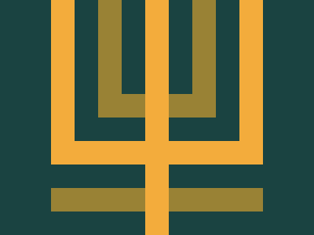

# CSS Battle #9

## [Level 45](https://cssbattle.dev/play/45)


| Character count | Score |
| --- | --- |
| 301 | 622.71 |

```html
<style>&{--a:conic-gradient(#F3AC3C)no-repeat;--b:conic-gradient(#998235)no-repeat;background:65px 0/30px 70%var(--a),185px 0/30px 100%var(--a),305px 0/30px 70%var(--a),50%45vw/90vh 10%var(--a),125px 0/30px 50%var(--b),245px 0/30px 50%var(--b),50%15ch/50vh 10%var(--b),50%30ch/90vh 10%var(--b),#1A4341
```

## [Level 46](https://cssbattle.dev/play/46)


| Character count | Score |
| --- | --- |
| 169 | 679.9 |

```html
<style>&{background:#293462;*{--a:/70%70%conic-gradient(#FE5F55)no-repeat;background:166%70%var(--a),118%283%var(--a)#FFF1C1;border-radius:50%;margin:50 100;rotate:45deg
```
